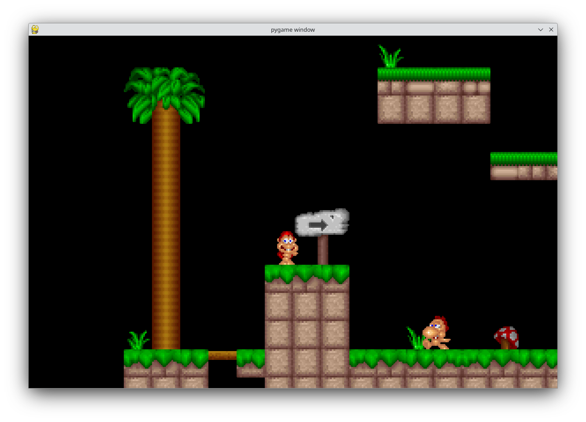
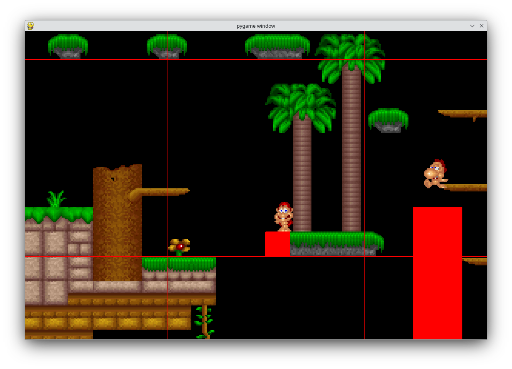

# 2D-Platformer

A simple 2D platformer written in C17 with raylib.



## Highlights

* Data-oriented character behaviors in `src/characters.c`.

* Raylib rendering at a 600x400 logical resolution with pixel-perfect window scaling.

  

* Custom [Tiled](https://www.mapeditor.org/) JSON support, including character spawning and collision metadata.

* Also includes:

    * Static tile collisions and dynamic character collisions.
    * Offset-based side-scrolling camera.
    * State-driven character sprite animations.

## Build

Requires a C17 compiler, `pkg-config`, and raylib.

The render options are compile-time flags in `src/constants.h`:

* `RENDER_CHUNKS=1` enables the tilemap chunk cache; `0` draws visible tiles directly.
* `RENDER_BACKEND=RENDER_BACKEND_SOFTWARE` composes chunks with raylib `Image` operations on the CPU.
* `RENDER_BACKEND=RENDER_BACKEND_GPU` builds chunks through raylib render targets.

Raylib still presents the final frame through its graphics context in both modes; “software” here refers to CPU tile composition, not a fully software window backend. Override a flag when compiling, for example: `gcc ... -DRENDER_CHUNKS=0`.

```bash
./run/dev.sh       # builds and runs bin/dbg-linux/platformer
./run/build.sh     # bin/rel-linux/platformer
```

On Windows, use MSYS2 UCRT64 (GCC, GDB, pkg-config, and raylib):

```powershell
.\run\dev.ps1             # builds and runs bin/dbg-windows/platformer.exe
.\run\dev.ps1 -BuildOnly  # builds the debug version without running it
.\run\build.ps1           # bin/rel-windows/platformer.exe
```

Run either executable from the project root so it can find `maps/`, `graphics/`, and `sound/`.
